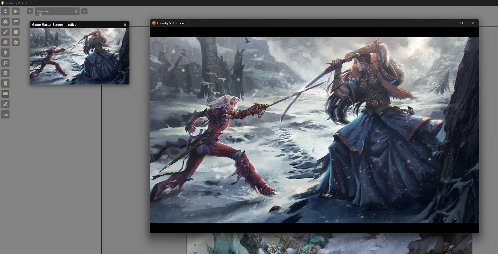

# Game Master Screen

A Foundry VTT module for a full-screen, GM-controlled overlay — for pauses, intermissions, and scene transitions — with a compact, non-blocking GM preview pane so triggering it never gets in the way of running the game.



## Features

- Manual **Trigger** / **Close**, **Trigger Preset** one-off overrides, optional **scene-activation** auto-trigger, and a scripting API (`game.modules.get("game-master-screen").api`)
- **Single image**, **image list** (rotate / shuffle), or **video**, plus universal audio, fit, loop/mute/volume, duration, and fade in/out
- **Presets** (save, rename, reorder, delete) and per-scene **Inherit / Override / Disable** on the Scene Config tab
- Full-bleed **player overlay** (input locked) and draggable **GM popout** that does not block the canvas; late-join catch-up; any GM can close for everyone

## Install

In Foundry, open **Add-on Modules → Install Module** and paste the manifest URL:

```
https://github.com/esterlinej/game-master-screen/releases/latest/download/module.json
```

Or pick a version from [GitHub Releases](https://github.com/esterlinej/game-master-screen/releases).

Enable the module in your world, then use the **Game Master Screen** scene-controls toolbar (clapperboard icon) or open **Settings** from the same toolbar to configure media.

## Documentation

**[Visual guide](docs/GUIDE.md)** — screenshot walkthrough of the toolbar, Settings, media modes, presets, and per-scene overrides.

## Quick start

1. Open scene controls → **Settings** → choose a media mode and paths, then **Save Changes**.
2. Click **Trigger** to show the overlay for players and the GM popout locally.
3. Click **Close** (or wait for duration) to dismiss for everyone.

**Macro / API** (GM-only for trigger/close):

```js
const api = game.modules.get("game-master-screen").api;
await api.trigger();
await api.triggerPreset("Ambush!");
await api.close();
api.isActive();
```

## Compatibility

| | Version |
|--|---------|
| Foundry VTT | **14** (`minimum` / `maximum` 14) |
| Foundry verified | **14.370** |

V13 is not supported — the Scene Config override tab relies on V14's ApplicationV2 sheet structure.

## Changelog & license

See [CHANGELOG.md](CHANGELOG.md). MIT — see [LICENSE](LICENSE).

**Jester** — [github.com/esterlinej](https://github.com/esterlinej)
